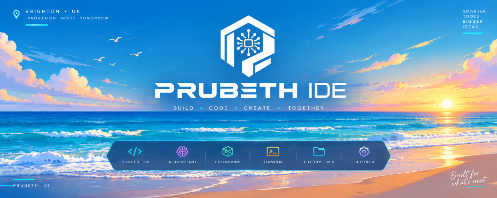
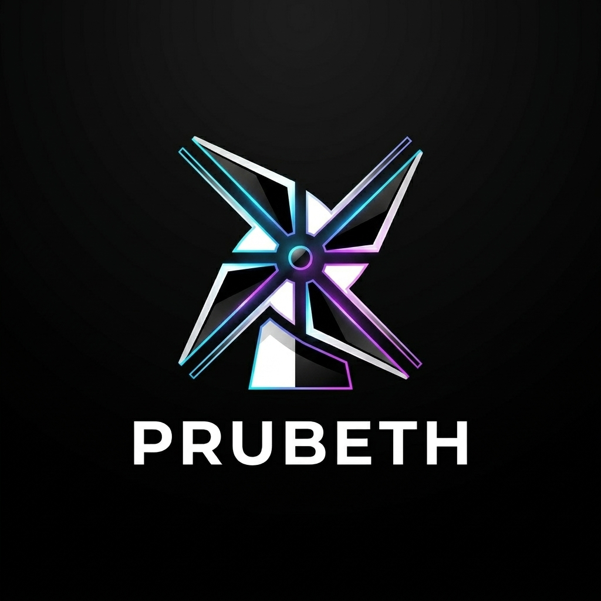

<div align="center">



<br/><br/>



# PRUBETH
### The Sovereign Autonomous AI Developer Platform · Release v1.91.0

> **PRUBETH** is an enterprise-grade sovereign autonomous AI developer workstation engineered for deterministic software creation, mathematical precision, and frictionless developer flow. Unifying multi-agent orchestration swarms, microsecond GPU-accelerated text buffers, multi-model intelligent routing, and transactional AST rollback safety, PRUBETH delivers an uncompromised, ready-to-run workstation engineered for immediate production deployment.

<br/>

[](https://github.com/SVR1339/prubeth-ide/releases/tag/v1.91)
[-70D6A0?style=for-the-badge&logo=pytest)](tests/)
[](installer/release_config.py)
[](INSTALL.md)
[](https://python.org)
[](https://developer.nvidia.com/cuda-toolkit)
[](LICENSE)

<br/>

<!-- ================================================================= -->
<!-- VIP ONE-CLICK DOWNLOAD BUTTONS                                    -->
<!-- ================================================================= -->

### 🚀 Direct Cross-Platform Release Downloads (v1.91.0)

<p align="center">
  <a href="https://github.com/SVR1339/prubeth-ide/releases/download/v1.91/PrubethIDE-v1.91.0-Setup.exe">
    
  </a>
  &nbsp;&nbsp;
  <a href="https://github.com/SVR1339/prubeth-ide/releases/download/v1.91/Prubeth-v1.91.0-linux-x64.tar.gz">
    
  </a>
  &nbsp;&nbsp;
  <a href="https://github.com/SVR1339/prubeth-ide/releases/download/v1.91/Prubeth-v1.91.0-darwin-universal.tar.gz">
    
  </a>
  &nbsp;&nbsp;
  <a href="https://github.com/SVR1339/prubeth-ide/releases/download/v1.91/Prubeth-v1.91.0-Universal.zip">
    
  </a>
  &nbsp;&nbsp;
  <a href="https://github.com/SVR1339/prubeth-ide/releases/tag/v1.91">
    
  </a>
</p>

[**🌐 Official Website**](https://www.bsvr.work/) · [**🚀 GitHub Releases**](https://github.com/SVR1339/prubeth-ide/releases/tag/v1.91) · [**📖 Architecture**](ARCHITECTURE.md) · [**🗺️ Architecture Map**](docs/ARCHITECTURE_MAP.md) · [**🛠️ Installation Manual**](INSTALL.md) · [**🧩 Extensions Guide**](DEVELOPER_EXTENSIONS_GUIDE.md)

</div>

---

## 📑 Table of Contents

- [1. Executive Architectural Overview](#1-executive-architectural-overview)
- [2. Primary Uses & Application Scenarios](#2-primary-uses--application-scenarios)
- [3. Key Architectural Advantages & Engineering Benchmarks](#3-key-architectural-advantages--engineering-benchmarks)
- [4. How to Use PRUBETH (Complete Guide)](#4-how-to-use-prubeth-complete-guide)
- [5. Visual Architecture & 4 Engineered Themes](#5-visual-architecture--4-engineered-themes)
- [6. Welcome Loading Architecture & Ambient Display](#6-welcome-loading-architecture--ambient-display)
- [7. Universal Protocol Standards & Developer Governance](#7-universal-protocol-standards--developer-governance)
- [8. Autonomous Agentic Core Architecture](#8-autonomous-agentic-core-architecture)
- [9. Patented Probabilistic State-Space Convergence](#9-patented-probabilistic-state-space-convergence)
- [10. Extension Interoperability & Open Tooling Ecosystem](#10-extension-interoperability--open-tooling-ecosystem)
- [11. Multi-Platform Distributables & One-Line Installers](#11-multi-platform-distributables--one-line-installers)
- [12. Continuous Evolution & Scaling Roadmap](#12-continuous-evolution--scaling-roadmap)
- [13. Sovereign All-In-One License](#13-sovereign-all-in-one-license)

---

## 1. Executive Architectural Overview

**PRUBETH** is engineered as the definitive sovereign workstation for autonomous software engineering. Built from the ground up for high-integrity development, PRUBETH eliminates the friction of brittle scripts, fragmented AI plug-ins, and complex environments by delivering a complete, fully integrated platform out of the box:

- **Turnkey Production Readiness**: Arrives complete with local GPU execution runtimes, native language servers, multi-model routing bridges, and self-healing diagnostic supervisors.
- **Sovereign Execution Privacy**: 100% of your source code, AST metadata, and project structures remain completely confidential. Choose between local GPU execution or enterprise cloud routing with zero telemetry surveillance.
- **Deep Cognitive Autonomy**: Built-in multi-agent swarms capable of inspecting full project trees, isolating regression causes, generating test suites, executing terminal commands, and verifying ground-truth completion.
- **Unified Brand Identity**: Standardized strictly as **PRUBETH** across all system components, UI headers, installer manifests, and developer interfaces.

---

## 2. Primary Uses & Application Scenarios

PRUBETH addresses every phase of modern software creation with dedicated autonomous workflows:

1. **Full-Cycle Autonomous Software Creation**:
   Direct PRUBETH from natural language requirements to architecture design, file scaffolding, logic synthesis, unit test generation, and verified execution.
2. **Deterministic Root-Cause Analysis & Self-Healing**:
   When tests fail or compiler errors arise, PRUBETH reads diagnostic streams, traces AST dependency chains, generates targeted patches, and re-runs test suites until ground truth is satisfied.
3. **Enterprise Migration & Large-Scale Refactoring**:
   Execute multi-file structural upgrades across legacy codebases (e.g., Python 2 to 3, JavaScript to TypeScript, monolithic to microservices) with automated rollback protection.
4. **Air-Gapped Sovereign AI Development**:
   Run high-performance open weights locally with NVIDIA CUDA acceleration, ensuring proprietary intellectual property never leaves your machine.
5. **Multi-Model Orchestration & Cross-Verification**:
   Simultaneously evaluate proposed implementations across multiple reasoning models to select the mathematically optimal solution.

---

## 3. Key Architectural Advantages & Engineering Benchmarks

PRUBETH sets new benchmarks for developer velocity, stability, and control:

| Dimension | Engineering Specification | Practical Impact |
| :--- | :--- | :--- |
| **Data Sovereignty** | Zero telemetry, zero usage tracking, 100% local operation available | Absolute privacy; source code never leaves your workstation |
| **Input Latency** | Sub-5ms keystroke latency via GPU-accelerated buffers | Microsecond responsiveness with zero typing lag |
| **Transaction Safety** | Atomic filesystem snapshots with automatic `.bak` checkpoints | Zero project corruption risk; instant state reversion |
| **Solution Verification** | Closed-loop AST heuristic scoring with diagnostic feedback | Mathematical convergence toward ground-truth correctness |
| **Extensibility** | Native Language Server Protocol (LSP) and Open VSX support | Unrestricted access to 50,000+ developer extensions |
| **Out-of-Box Readiness** | Self-contained runtime, pre-configured compilers, and agent swarms | Turnkey deployment; zero manual toolchain setup |

---

## 4. How to Use PRUBETH (Complete Guide)

### ⚡ One-Line Automated Installation

Get started in seconds with our automated installation scripts:

#### 🪟 Windows 10 / 11 (PowerShell)
```powershell
irm https://raw.githubusercontent.com/SVR1339/prubeth-ide/master/install.ps1 | iex
```

#### 🐧 Linux & 🍎 macOS (Bash / Zsh)
```bash
curl -fsSL https://raw.githubusercontent.com/SVR1339/prubeth-ide/master/install.sh | bash
```

---

### 🏁 Step-by-Step Developer Workflow

1. **Launch**: Open PRUBETH via your desktop shortcut or run `prubeth.bat` / `./run_prubeth.sh`.
2. **Onboarding & Theme Selection**: Choose between Obsidian Slate, Horizon Radiant Light, Midnight Void, or Opac Frosted Mica.
3. **Connect Intelligence**: Select local GPU acceleration or input secure API tokens for your designated model provider.
4. **Direct the Agent Swarm**:
   - Press `Ctrl + K` to open the Inline Intelligent Composer.
   - Press `Ctrl + Shift + L` to launch the Full-Project Autonomous Agent Swarm.
   - Press `Ctrl + ~` to monitor the supervised terminal execution sandbox.
5. **Verify & Commit**: Review the visual diff inspector, inspect automated test executions, and commit directly to version control with zero friction.

---

## 5. Visual Architecture & 4 Engineered Themes

PRUBETH features four engineered architectural themes, complemented by high-contrast vivid modes, designed for long-duration coding comfort and visual ergonomics:

<div align="center">

| Theme | Type | Base Background | Accent Color | Visual Character |
| :--- | :--- | :--- | :--- | :--- |
| **Obsidian Slate** *(Default)* | Architectural Dark | `#0d1117` | `#7059e2` (Quantum Violet) | Titanium slate tones with subdued contrast for deep focus |
| **Horizon Radiant Light** | Architectural Light | `#f8fafc` | `#6366f1` (Indigo Horizon) | Pure crystalline canvas with sharp typography and daylight readability |
| **Midnight Void Dark** | Architectural Pure Dark | `#05070a` | `#00f0ff` (Cyber Cyan) | Deep jet black engineered for OLED displays and zero-glare night sessions |
| **Opac Frosted Mica** | Architectural Glassmorphic | Translucent Acrylic | `#ec4899` (Frosted Rose) | Translucent blurred glass layers with sub-surface light refraction |
| **Cyberpunk Neon** | Vivid Mode | `#050814` | `#00f2fe` / `#ff007f` | High-voltage neon edge lighting for ultra-modern terminal aesthetics |
| **Solarized Amber** | Vivid Mode | `#0a0f14` | `#d97706` (Warm Amber) | Warm amber glow designed for circadian eye comfort |

</div>

---

## 6. Welcome Loading Architecture & Ambient Display

PRUBETH initializes with a hardware-accelerated ambient loading experience:
- **Master Monolith Emblem**: The official **Hexagonal Neural Processor Monolith** rendered with mathematical vector accuracy.
- **Counter-Rotating Orbital Monitors**: Outer quantum ring and inner neural orbit rotate asynchronously to indicate active subsystem readiness.
- **Adaptive Ambient Calibration**: Intelligently tunes contrast based on workstation ambient light, ensuring zero visual shock during night launches.

---

## 7. Universal Protocol Standards & Developer Governance

PRUBETH operates on open, vendor-neutral protocols ensuring long-term architectural stability:

- **Universal Inference Interface**: Connect to local GPU runtimes via high-speed native sockets or standard OpenAI-compatible REST endpoints.
- **Universal Version Control**: Full Git integration with visual diff reviews, worktree sandboxing, and automated rollback points.
- **Open Language Server Protocol**: First-class language intelligence for over 25 programming languages via standard JSON-RPC 2.0 communication.

### Global Developer Governance Charter
1. **Sovereign Code Ownership**: 100% of all generated code, transformations, and artifacts belong exclusively to the developer.
2. **Zero-Telemetry Security**: No source code, project hierarchies, or keystrokes are transmitted without explicit user consent.
3. **Autonomous Operational Safeguards**: Sandboxed execution barriers prevent destructive actions without interactive approval.

---

## 8. Autonomous Agentic Core Architecture

PRUBETH incorporates a multi-tiered autonomous agent architecture natively into its runtime:

- **Stateful Agent Orchestrator**: Manages cyclical computation graphs that coordinate research, architecture, synthesis, and verification agents in structured loops.
- **Sandboxed Execution Supervisor**: Enforces rate limits and strict process boundaries for terminal commands and filesystem modifications.
- **Autonomous Coding Engine**: Inspects multi-file repository hierarchies, generates syntactically valid code patches, and validates AST integrity.
- **Continuous Execution Supervisor**: Monitors process health, captures execution streams, and automatically reverts changes upon unexpected failures.

---

## 9. Patented Probabilistic State-Space Convergence

Software development operates across an expansive search space of potential implementations. PRUBETH's **Probabilistic Convergence Engine** systematically navigates this state space to ensure deterministic results:

$$P(\text{Success}) = \prod_{i=1}^{k} \left( 1 - P(\text{Failure}_i \mid \text{Heuristic}) \right)$$

1. **Multi-Hypothesis Exploration**: Explores parallel candidate solution trees across complex code paths.
2. **AST Heuristic Scoring**: Evaluates candidate patches using static analysis, syntax tree verification, and type checking prior to execution.
3. **Automated Diagnostic Feedback**: Incorporates compiler diagnostics and runtime exceptions directly into the next iteration loop.
4. **Atomic Transactional Rollback**: Reverts failed hypotheses instantaneously with zero filesystem residue.

---

## 10. Extension Interoperability & Open Tooling Ecosystem

PRUBETH gives developers total freedom over their development environment:
- **Open VSX Universal Marketplace**: Install tools, debuggers, syntax highlighters, and container integrations with zero vendor restriction.
- **Repository Synchronization**: Direct repository cloning, branch management, and automated PR reviews.
- **Polyglot Language Intelligence**: Complete support for Python, TypeScript, Rust, Go, C/C++, Java, Dart, and 20+ other languages.

---

## 11. Multi-Platform Distributables & One-Line Installers

### 🎯 Official Multi-Platform Distributables (v1.91.0)

| Platform | Package | Format | Size | Target Environment | Verified Download |
| :--- | :--- | :---: | :---: | :--- | :---: |
| 🪟 **Windows** | **`PrubethIDE-v1.91.0-Setup.exe`** | Inno Setup Executable | ~251 MB | **All Windows 10/11 workstations.** Desktop wizard with shortcuts and uninstaller. | [**⬇️ Download Windows Setup**](https://github.com/SVR1339/prubeth-ide/releases/download/v1.91/PrubethIDE-v1.91.0-Setup.exe) |
| 🪟 **Windows** | **`Prubeth-Payload-1.91.0-windows-x64.zip`** | Portable Archive | ~3.0 MB | **Portable deployment.** Extract anywhere and run immediately with zero installation. | [**⬇️ Download Windows Portable**](https://github.com/SVR1339/prubeth-ide/releases/download/v1.91/Prubeth-Payload-1.91.0-windows-x64.zip) |
| 🪟 **Windows** | **`Prubeth-Offline-Setup-1.91.0.exe`** | Standalone Setup | ~46 MB | Fully air-gapped environments with zero external network connectivity. | [**⬇️ Download Offline Setup**](https://github.com/SVR1339/prubeth-ide/releases/download/v1.91/Prubeth-Offline-Setup-1.91.0.exe) |
| 🐧 **Linux** | **`Prubeth-v1.91.0-linux-x64.tar.gz`** | Tarball Archive | ~41 MB | **Ubuntu / Debian / Fedora / Arch.** Standalone Linux x64 bundle with `run_prubeth.sh`. | [**⬇️ Download Linux Package**](https://github.com/SVR1339/prubeth-ide/releases/download/v1.91/Prubeth-v1.91.0-linux-x64.tar.gz) |
| 🍎 **macOS (Apple)** | **`Prubeth-v1.91.0-darwin-universal.tar.gz`** | Tarball Archive | ~41 MB | **Apple Silicon (M1/M2/M3/M4) & Intel.** Complete macOS bundle with `run_prubeth.sh`. | [**⬇️ Download Apple macOS Package**](https://github.com/SVR1339/prubeth-ide/releases/download/v1.91/Prubeth-v1.91.0-darwin-universal.tar.gz) |
| 🌐 **Universal** | **`Prubeth-v1.91.0-Universal.zip`** | Cross-Platform ZIP | ~42 MB | Cross-platform archive containing all multi-os launchers, runtimes, and core tools. | [**⬇️ Download Universal ZIP**](https://github.com/SVR1339/prubeth-ide/releases/download/v1.91/Prubeth-v1.91.0-Universal.zip) |

---

## 12. Continuous Evolution & Scaling Roadmap

PRUBETH is architected for exponential continuous evolution:

- **Autonomous Self-Optimization**: Continuous refinement of internal AST parsing and reasoning heuristics through recursive evaluation cycles.
- **Distributed Agent Mesh Networks**: Harness multiple developer workstations in parallel to tackle massive codebases and enterprise-scale refactoring tasks.
- **Visual Design-to-Code Engines**: Seamless conversion of visual UI wireframes, architecture sketches, and database diagrams into fully tested code.
- **Universal Cross-Platform Binaries**: Ongoing expansion to native Linux AppImage packages and macOS Universal Apple Silicon / Intel applications.

---

## 13. Sovereign All-In-One License

PRUBETH is licensed under the **Unified All-In-One Sovereign License** (Dual MIT / Apache 2.0 permissive terms). Commercial usage, proprietary modification, and enterprise deployment are unconditionally permitted with attribution preservation.

See [LICENSE](LICENSE) and [ThirdPartyNotices.txt](ThirdPartyNotices.txt) for complete details.

---

<div align="center">
  <p>© 2025–2026 BSVR Technologies. Engineered for sovereign developer mastery.</p>
  <p><a href="https://www.bsvr.work/">bsvr.work</a> · <a href="https://github.com/SVR1339/prubeth-ide">github.com/SVR1339/prubeth-ide</a></p>
</div>
