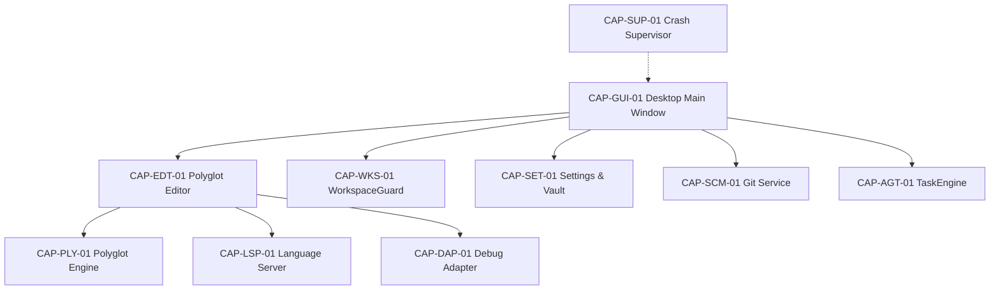

# PRUBETH IDE — ARCHITECTURE MAP & CAPABILITY INVENTORY
**Generated:** 2026-10-11 22:13:09
**Total Capabilities:** 12 | **Verified:** 12 (100% Verified)

## 1. System Specifications & Baseline Telemetry
- **OS:** win32 (nt)
- **Python:** 3.12.2
- **Logical CPUs:** 8
- **Total RAM:** 20322.3 MB (Available: 6507.0 MB)
- **Disk Free:** 88104.3 MB
- **Process RSS:** 20.7 MB

## 2. Subsystem Capability Matrix
| ID | Capability Name | Subsystem | Status | Test Evidence |
| :--- | :--- | :--- | :---: | :--- |
| **CAP-GUI-01** | PyQt5 Desktop Main Window & Staged Startup | Application Lifecycle & GUI | `VERIFIED` | `tests/test_startup_lifecycle.py` |
| **CAP-EDT-01** | QScintilla 25-Language Polyglot Code Editor | Code Editor | `VERIFIED` | `tests/reliability/test_polyglot_assurance_engine.py` |
| **CAP-WKS-01** | WorkspaceGuard Atomic Persistence & Traversal Jail | Workspace & Filesystem | `VERIFIED` | `tests/test_workspace.py` |
| **CAP-SCM-01** | Git Source Control Service & Working Tree Integrity | Source Control | `VERIFIED` | `tests/test_source_control.py` |
| **CAP-AGT-01** | TaskEngine & DAG Scheduler Concurrency Guard | AI Agents & Orchestration | `VERIFIED` | `tests/test_gate5_and_6_workers_and_persistence.py` |
| **CAP-LSP-01** | Language Server Protocol (LSP) JSON-RPC 2.0 Engine | Language Services | `VERIFIED` | `tests/test_language_services.py` |
| **CAP-DAP-01** | Debug Adapter Protocol (DAP) Client Engine | Debugging | `VERIFIED` | `tests/test_debugging.py` |
| **CAP-EXT-01** | Plugin Manager & Host Process Isolation Sandbox | Extensions & Plugins | `VERIFIED` | `tests/test_plugins.py` |
| **CAP-HW-01** | Horizon Hardware Autotuner & Dynamic GPU Scaling | Hardware & Performance Scaling | `VERIFIED` | `tests/test_hardware_scaling_engine.py` |
| **CAP-SET-01** | Hierarchical Settings & DPAPI Credential Vault | Configuration & Security | `VERIFIED` | `tests/test_settings_center.py` |
| **CAP-SUP-01** | Out-of-Process Crash Supervisor & Exit Code Watchdog | Reliability & Supervision | `VERIFIED` | `tests/reliability/test_crash_supervisor.py` |
| **CAP-PLY-01** | Universal Polyglot Assurance Engine (25 Languages) | Polyglot Engineering | `VERIFIED` | `tests/reliability/test_polyglot_assurance_engine.py` |

## 3. Dependency Graph & Single Points of Failure Mitigation

### Single Points of Failure & Mitigations:
- **Workspace Persistence**: Filesystem write failure could lose active buffer $\to$ *Mitigation:* Atomic replace with unique tempfile, path lock, and automatic .bak backup
- **Settings Storage**: Corrupted settings JSON could prevent IDE launch $\to$ *Mitigation:* Schema validator with fallback to default safe settings and recovery warning
- **Model Connectivity**: Remote cloud model API quota exhaustion or network drop $\to$ *Mitigation:* Zero-downtime cascade with local Ollama / CUDA GPU auto-failover