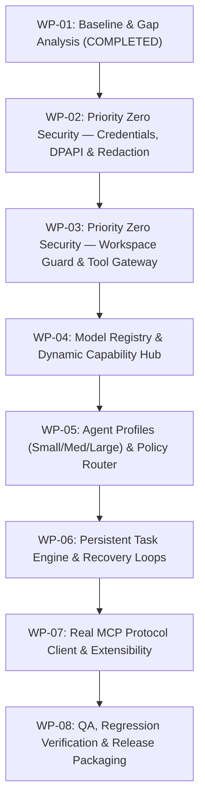

# SO NAIVE IDE — Implementation Roadmap (PRINCE2 Agile Work Packages)
**Document ID:** DOC-ASSESS-003  
**Version:** 3.0.0-RC1  
**Date:** October 10, 2026  

---

## Work Package Breakdown & Execution Sequence

### Work Package Specifications:
1. **WP-01: Baseline & Assessment Audit (Status: COMPLETED)**
   - Audit code, tests, installers, and establish baseline test pass rate (27/27).
2. **WP-02: Secure Credentials & Secret Redaction (Status: IMMEDIATE PRIORITY)**
   - Implement `core/credentials.py` using Windows DPAPI (`ctypes.windll.crypt32`) and AES-256-GCM fallback.
   - Idempotent migration of legacy plaintext keys from `settings.json` and `accounts.json`.
   - Secret redaction for exceptions, logs, and diagnostic exports.
3. **WP-03: Workspace Guard & Tool Security Gateway (Status: IMMEDIATE PRIORITY)**
   - Implement `core/workspace.py` with strict canonicalization preventing directory traversal (`../../`).
   - Implement `core/tool_gateway.py` replacing `subprocess.run(shell=True)` with structured execution, timeouts, and approval policies.
4. **WP-04: Model Hub & Capability Registry**
   - Implement `core/model_registry.py` with capability tracking (vision, tools, context limits, local/hosted).
5. **WP-05: Workload Agent Profiles & Deterministic Policy Router**
   - Implement `core/router.py` with Small, Medium, Large profiles and policy rules (Local-only, Privacy-first).
6. **WP-06: Task Execution Engine**
   - Implement `core/task_engine.py` with explicit states, checkpoints, and cancellation.
7. **WP-07: Real MCP Integration & Plugin Validation**
   - Implement real JSON-RPC stdio transport in `core/plugin_engine.py`.
8. **WP-08: Quality Assurance, Packaging & Release**
   - Run full regression suite, build standalone installer, and package release archives.
