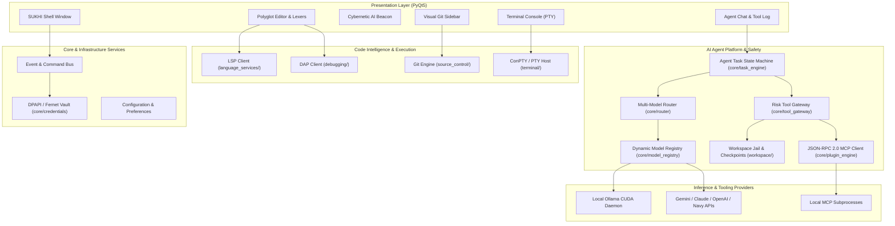

# SUKHI IDE — Horizon Edition
## MASTER ARCHITECTURE SPECIFICATION & SUBSYSTEM BLUEPRINT

**Specification Document:** ENG-ARCH-001  
**Target Version:** 3.0.0+ (Modular Subsystems)  
**Status:** Approved Architectural Standard  
**Effective Date:** October 10, 2026

---

### 1. Architectural Mission & Principles

SUKHI IDE is engineered as a high-throughput, security-first, extensible desktop development environment tailored for AI-augmented programming. The architecture transitions from an early monolithic prototype to a cleanly decoupled, service-oriented desktop application adhering to:

1. **Provider Independence:** Pluggable AI model integration supporting local CUDA edge inference (Ollama, vLLM) and enterprise cloud APIs (Gemini, Claude, OpenAI, NavyAI, Groq).
2. **Defensive Workspace Containment:** Uncompromising directory boundaries preventing path traversal, symlink escapes, or unapproved destructive operations.
3. **Decoupled Service Architecture:** Strict separation between UI presentation, editor buffer management, language servers (LSP), debug adapters (DAP), terminal emulators, version control, and AI agent runtimes.
4. **Zero-Plaintext Security:** Encrypted key vaults (Windows DPAPI and Linux Fernet AES-GCM) with continuous secret redaction pipelines across logs and UI streams.
5. **Recoverable Autonomy:** Multi-file atomic checkpoints enabling instant rollback of autonomous agent actions.

---

### 2. High-Level Subsystem Architecture

---

### 3. Subsystem Directory Taxonomy

The target codebase architecture organizes capabilities into 16 explicit modular subsystems:

| Subsystem Package | Primary Responsibility | Key Interfaces & Exports |
| :--- | :--- | :--- |
| **`core/`** | Application lifecycle, event bus, config, error logging. | `AppEventBus`, `StudioApp`, `ConfigManager` |
| **`ui/`** | Main shell, dock widgets, status bars, dialogs, dark theme QSS. | `MainWindow`, `CyberBeaconWidget`, `CommandPalette` |
| **`editor/`** | Buffer lifecycle, QScintilla lexers, tabs, dirty state, folding. | `EditorManager`, `CodeBuffer`, `LexerRegistry` |
| **`language_services/`**| Language Server Protocol (LSP) client, diagnostics, definition. | `LspClient`, `LspServerManager`, `DiagnosticStore` |
| **`debugging/`** | Debug Adapter Protocol (DAP) client, breakpoints, call stack. | `DapClient`, `BreakpointManager`, `DebugSession` |
| **`terminal/`** | ConPTY / POSIX PTY sessions, escape sequences, process trees. | `TerminalService`, `PtyProcess`, `ConsoleWidget` |
| **`source_control/`** | Git status, diff parsing, staging, commit composer, branch ops. | `GitService`, `GitStatusModel`, `GitSidebarWidget` |
| **`ai/`** | Context gathering, prompt compilation, RAG retrieval. | `ContextBuilder`, `CodeIndexService`, `SemanticSearch` |
| **`providers/`** | Model adapters (Gemini SSE, Ollama REST, NavyAI, Claude). | `BaseProvider`, `GeminiAdapter`, `OllamaAdapter` |
| **`tools/`** | Risk classification, command gateway, tool schemas, audit log. | `ToolGateway`, `ToolRegistry`, `RiskClassifier` |
| **`workspace/`** | Path canonicalization, traversal checks, multi-file checkpoints. | `WorkspaceGuard`, `CheckpointManager`, `FileOps` |
| **`extensions/`** | Manifest schema validator, extension registry, sandbox policies. | `ExtensionManager`, `ManifestValidator` |
| **`integrations/`** | Model Context Protocol (MCP) JSON-RPC 2.0 stdio client. | `RealMCPStdioClient`, `McpToolBridge` |
| **`testing/`** | Test discovery, runner harnesses, failure capturer, mocks. | `TestRunnerService`, `PytestBridge` |
| **`packaging/`** | Installer compiler, PyInstaller specs, portable zip packagers. | `build_setup_exe`, `build_installer` |
| **`docs/`** | Architecture blueprints, threat models, engineering metrics. | Markdown engineering archives |

---

### 4. Migration Strategy (From Monolith to Subsystems)

The existing [`local_ai_studio_pro.py`](file:///c:/Users/asus/heretic-work/local_ai_studio_pro.py) (5,787 lines) serves as the battle-tested runtime shell. The architectural migration follows a **zero-breakage facade pattern**:

1. **Extract & Isolate:** Implement pure backend subsystems (`workspace/checkpoints.py`, `source_control/git_service.py`, `language_services/lsp_client.py`, `debugging/dap_client.py`).
2. **Wire into Core Gateway:** Import new subsystems into `core/` and bind them to the existing UI actions in `local_ai_studio_pro.py`.
3. **Verify with Tests:** Author standalone unit and integration test suites in `tests/` asserting real functionality.
4. **Preserve Legacy Entrypoints:** Retain `local_ai_studio_pro.py` as the unified launcher script so all existing batch files, installers, and shortcuts continue working seamlessly.
